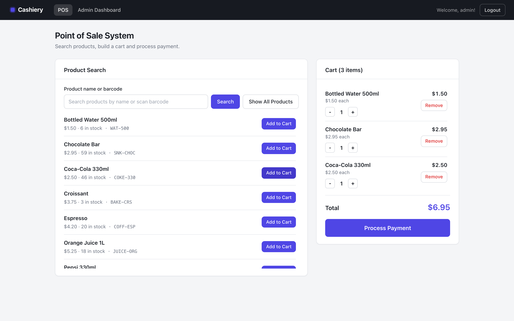
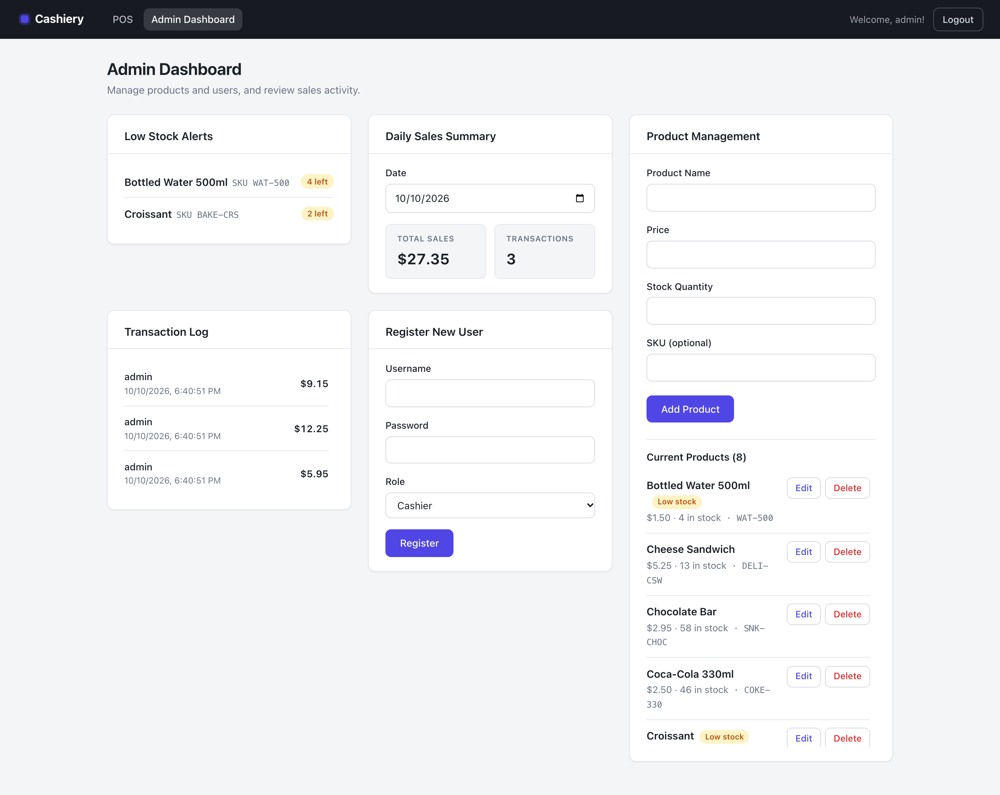

# Cashiery — POS & Inventory Management System

[](https://github.com/mahmoudhaytham25/cashiery-pos/actions/workflows/ci.yml)

A full-stack point-of-sale and inventory management web application with dual roles: a cashier interface for day-to-day sales and a manager dashboard for inventory control and reporting.

## Screenshots

| Point of Sale | Admin Dashboard |
| --- | --- |
|  |  |

## Features

**Cashier interface**
- Barcode/SKU product search and cart management
- Checkout flow with transaction logging

**Manager dashboard**
- Product & inventory management (CRUD, stock levels)
- Low-stock alerts
- Sales summaries and full transaction log
- Cashier user registration

**Platform**
- JWT authentication with role-based access (`cashier` / `admin`)
- Passwords hashed with bcrypt
- REST API backed by PostgreSQL

## Architecture

```
React Frontend (port 3000)  →  Express REST API (port 5000)  →  PostgreSQL
                                    ├─ /api/auth          — login, registration
                                    ├─ /api/products      — product & stock CRUD
                                    └─ /api/transactions  — checkout & sales history
```

## Stack

React (Vite) · Node.js (Express) · PostgreSQL · node-pg-migrate · JWT · bcrypt

## Getting Started

### Run with Docker (quickest start)

```bash
docker compose up --build
```

- Frontend: http://localhost:3000 · Backend API: http://localhost:5001 (host port is 5001 because macOS AirPlay Receiver occupies :5000; override with `BACKEND_PORT`)
- The backend container waits for Postgres, applies any pending database migrations (`node-pg-migrate`, see `backend/migrations/`), then starts the API — all handled by `backend/docker-entrypoint.sh` on every startup. To reset the DB entirely: `docker compose down -v && docker compose up --build`.
- First run: register via the app's sign-up form (or `POST /api/auth/register`). The very first account is created as `admin` automatically — registration is admin-gated afterwards.
- A fresh database also gets a small demo product catalog (`backend/scripts/seed.js`, runs only while the products table is empty — two items are low-stock so the alerts card shows data). Set `SEED_PRODUCTS=0` to skip it.
- `JWT_SECRET` is required by the backend and falls back to a dev-only value in `docker-compose.yml`. For anything real, set it via `JWT_SECRET=your-secret docker compose up` or a `.env` file at the repo root.
- DB credentials default to dev values; override with `POSTGRES_USER`, `POSTGRES_PASSWORD`, `POSTGRES_DB`.

### Prerequisites (local dev)
- Node.js 24+ (LTS)
- PostgreSQL

### Backend
```bash
cd backend
npm install
cp .env.example .env   # fill in your DB credentials and JWT secret
createdb your_db_name  # create the database (or: psql -c "CREATE DATABASE your_db_name;")
npm run migrate:up     # create/update the schema via node-pg-migrate
npm run seed           # optional: demo catalog (only if products table is empty)
npm start              # http://localhost:5000
```

### Database migrations

The schema is managed by [node-pg-migrate](https://salsita.github.io/node-pg-migrate/). Migration files in `backend/migrations/` are the source of truth (`backend/database/schema.sql` is kept as a reference only). Migrations use the same `DB_*` env vars as the app — `scripts/migrate.js` maps them to the `DATABASE_URL` node-pg-migrate expects, and a `DATABASE_URL` set directly takes precedence.

```bash
npm run migrate:up                 # apply all pending migrations
npm run migrate:down               # roll back the last applied migration
npm run migrate:create -- <name>   # scaffold a new migration file
```

### Frontend
```bash
cd frontend
npm install
npm run dev          # http://localhost:3000 (Vite dev server — proxies /api to :5000)
```

Production build: `npm run build` outputs static assets to `frontend/dist/` (preview locally with `npm run preview`).

## Deployment — AWS (Terraform/Terragrunt)

`infrastructure/` contains a complete IaC setup for running the app on AWS with **environment promotion**: pushes to `develop` build and deploy to a dev EC2 box; merging to `main` promotes the exact dev-verified images to a prod box via ECR manifest retagging — no rebuild. Four modules (`ecr`, `codebuild`, `compute`, `ci`) are wired via Terragrunt `dependency` blocks under `live/{shared,dev,prod}`.

```
push → develop → tests → diff paths → CodeBuild builds changed images → ECR (dev-*) → SSM redeploy dev box
merge → main   → tests → CodeBuild retags dev-latest → prod-* (no rebuild) → SSM redeploy prod box
```

- GitHub Actions authenticates via **OIDC** — no AWS keys stored in secrets
- Secrets (`JWT_SECRET`, DB password) are generated by Terraform, never committed
- `docker-compose.prod.yml` mirrors the dev stack but pulls images instead of building

Full design, deploy steps and cost notes: [infrastructure/README.md](infrastructure/README.md)

## Testing

```bash
cd backend && npm test            # Jest API/unit tests
cd frontend && npm test           # Vitest + Testing Library
cd frontend && npm run test:e2e   # Playwright — needs backend on :5000 (see frontend/e2e/README.md)
```

## License

See [LICENSE](LICENSE).
